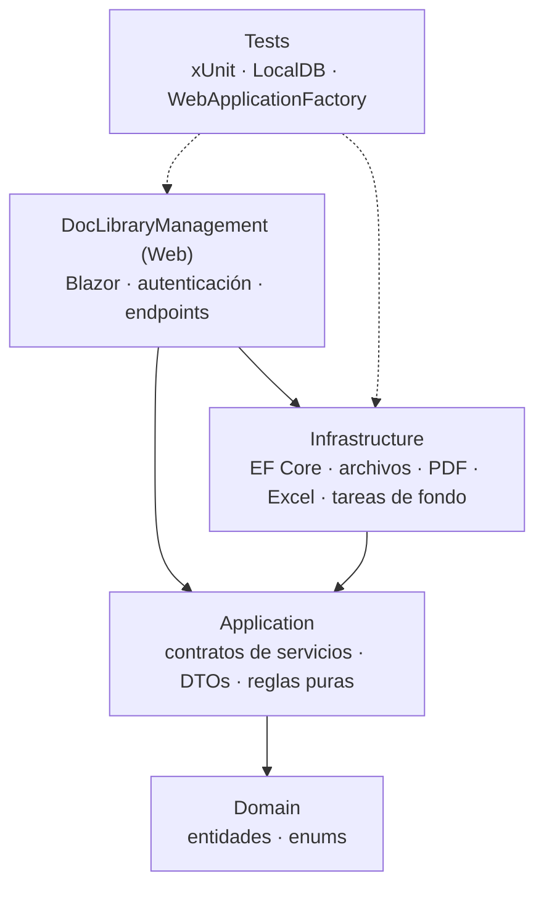
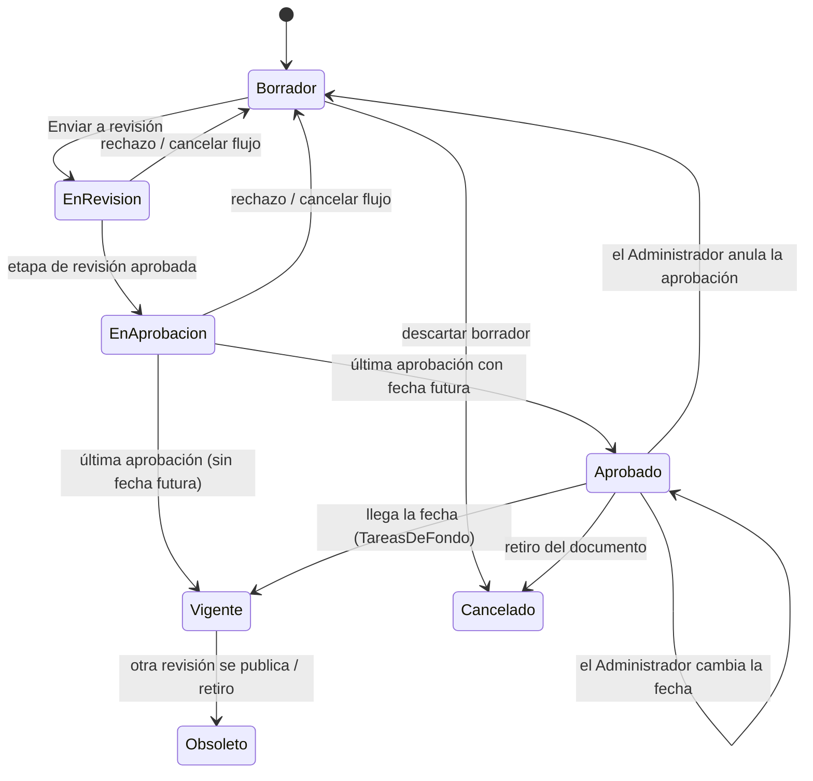

# Sistema de Gestión Documental (DocLibraryManagement)

Sistema web para el **control de información documentada** de una planta, basado en la cláusula **7.5 de ISO 9001:2015**
(estructura Annex SL, extensible a ISO 14001 y 45001). Controla qué documentos existen, quién los elaboró, revisó y
aprobó, cuál es la revisión **vigente**, y garantiza que nadie use una revisión obsoleta.

- **Stack:** C# / .NET 10, Blazor Web App (render interactivo de servidor), EF Core 10, SQL Server.
- **Escala de diseño:** menos de 100 usuarios y menos de 1,000 documentos, en red interna.
- **Idioma:** interfaz, mensajes y nombres de dominio en español.

> **Documento complementario:** [`docs/PROMPT-DESARROLLO.md`](docs/PROMPT-DESARROLLO.md) es el requerimiento original con
> **todas las decisiones de diseño y su historial de versiones**. Este README explica *cómo está construido y cómo operarlo*;
> aquel explica *qué se decidió y por qué*. Ante una duda de negocio, manda ese documento.

---

## Tabla de contenido

1. [Estado del proyecto](#1-estado-del-proyecto)
2. [Arranque rápido](#2-arranque-rápido)
3. [Arquitectura](#3-arquitectura)
4. [Estructura del repositorio](#4-estructura-del-repositorio)
5. [Modelo de dominio y reglas de negocio](#5-modelo-de-dominio-y-reglas-de-negocio)
6. [Seguridad](#6-seguridad)
7. [Configuración](#7-configuración)
8. [Pruebas](#8-pruebas)
9. [Puesta en producción](#9-puesta-en-producción)
10. [Consideraciones de diseño actuales y limitaciones](#10-consideraciones-de-diseño-actuales-y-limitaciones)
11. [Plan y consideraciones futuras](#11-plan-y-consideraciones-futuras)
12. [Guía de desarrollo](#12-guía-de-desarrollo)

---

## 1. Estado del proyecto

| Fase | Contenido | Estado |
|---|---|---|
| 1 | Capas, modelo de datos, autenticación, roles, bitácora | Terminada y validada |
| 2A | Catálogos (áreas, subáreas, tipos) y creación de documentos con código automático | Terminada y validada |
| 2B | Archivos (PDF + fuente), plantillas de flujo, revisión/aprobación, rechazo | Terminada y validada |
| 2C | Publicación, vigencia diferida, revisiones mayor/menor, dueño de área, retiro | Terminada y validada |
| 3 | Lista maestra + exportación, búsqueda por contenido, visor y enlace estable | Terminada y validada |
| 3+ | Ajuste: el Administrador puede cambiar la fecha o anular una aprobación que aún no entra en vigor | **Construido; validación manual pendiente** |
| 4 | Vencimientos de la revisión periódica, alertas, correo, reportes | **No iniciada** |
| 5 | Endurecimiento, guía de operación, script de despliegue | **No iniciada** |

**Verificación automatizada:** 525 pruebas (unitarias, de integración contra SQL Server y HTTP contra la aplicación real).
**No hay pruebas de interfaz en navegador:** los clics dentro de las pantallas (subir con el selector de archivos, elegir
personas en desplegables, botones) solo se han validado manualmente.

### Lo que NO está listo para producción (leer antes de desplegar)

1. **El SSO con Windows no se verificó de extremo a extremo.** El servidor emite el desafío `Negotiate` correctamente, pero
   en el equipo de desarrollo (no unido a un dominio clásico) el apretón de manos falla con `InvalidToken`. Hay que
   validarlo en un servidor unido al dominio con los grupos reales de AD. Ver [§6](#6-seguridad) y [§9](#9-puesta-en-producción).
2. **Entra ID / OpenID Connect no está implementado.** Solo existen el modo `Windows` y el modo `Desarrollo`.
3. **No se envían correos** ni hay alertas de vencimiento (Fase 4). La fecha de próxima revisión se calcula y se guarda,
   pero nada la consume todavía.
4. **El script de despliegue y la guía de operación no existen** (Fase 5). La protección de la tabla de auditoría a nivel
   de permisos de BD está **diseñada pero no escrita** (ver [§6.5](#65-bitácora-de-auditoría)).
5. **Pendientes de datos reales:** grupos de AD, servidor SMTP, ruta del almacén de archivos, política de respaldo.

---

## 2. Arranque rápido

### Requisitos

| Herramienta | Versión | Para qué |
|---|---|---|
| .NET SDK | 10.0.x (probado con 10.0.403) | compilar y ejecutar |
| SQL Server | LocalDB (desarrollo) o SQL Server | base de datos. **Solo se ha ejecutado contra LocalDB de SQL Server 2025 (v17.0)**; validar la versión del servidor destino antes de producción |
| Git | cualquiera | control de versiones |

Visual Studio es opcional: la solución es un archivo `.slnx` (abrir `DocLibraryManagement.slnx`).

### Pasos

```powershell
# 1. Restaurar la herramienta local de EF Core (dotnet-ef 10.0.14, fijada en dotnet-tools.json)
dotnet tool restore

# 2. Ejecutar (crea y migra la BD de desarrollo sola al arrancar)
dotnet run --project DocLibraryManagement --launch-profile http
#   -> http://localhost:5273          (perfil https: https://localhost:7202)
```

> Ejecuta los comandos **desde la carpeta de la solución**. Con `--project DocLibraryManagement` desde otra carpeta
> aparece el error *"The provided file path does not exist"*. Alternativa: pasar la ruta completa al `.csproj`.

Al abrir la aplicación en **modo Desarrollo** aparece la pantalla *Acceso de desarrollo* con usuarios simulados
(definidos en `appsettings.Development.json`):

| Persona | Rol | Para probar |
|---|---|---|
| Laura Lectora | Lector | consulta: lista maestra, búsqueda, visor |
| Alberto Autor (Calidad) | Autor del área `CAL` | crear documentos, subir PDF, enviar a revisión |
| Rosa Revisora | Revisor | etapas de revisión |
| Andrés Aprobador | Aprobador | etapas de aprobación (y dueño de área si se designa) |
| Aurora Auditora | Auditor | solo lectura de todo, incluidas obsoletas |
| Adrián Administrador | Administrador | catálogos, flujos, retiro de documentos |

**Recorrido mínimo para ver el sistema completo:**
1. Como *Administrador*: crear un tipo (`PRO`), un área (`CAL`), asociar el tipo al área, definir el flujo del tipo
   (Revisión → Aprobación) y designar un *dueño del área*.
2. Entrar una vez como *Revisor* y como *Aprobador* (el sistema solo ofrece como candidatos a quienes ya han entrado).
3. Como *Autor*: crear un documento, subir un PDF con texto, **Enviar a revisión** eligiendo revisor y aprobador.
4. Como *Revisor* y *Aprobador*: **Mis tareas** → aprobar. Al aprobar la última etapa el documento queda **Vigente**.
5. Como *Lector*: **Buscar** una palabra del PDF → abrir el resultado → ver el PDF en el visor.

### Comandos habituales

```powershell
dotnet test                                   # toda la suite (requiere LocalDB)
dotnet build DocLibraryManagement.slnx        # compilar todo
dotnet publish DocLibraryManagement -c Release -o <carpeta>   # publicar
```

**Si la aplicación está corriendo, bloquea las DLL** y `dotnet build` falla (MSB3026). No hace falta detenerla: compilar
y probar a otra carpeta de salida:

```powershell
dotnet test DocLibraryManagement.Tests "-p:OutDir=$env:TEMP\dl-build\"
```

---

## 3. Arquitectura

Solución en capas con dependencias **hacia adentro**. Las reglas de negocio viven en `Domain`/`Application`, nunca en los
componentes Blazor ni en el `DbContext`.



| Capa | Proyecto | Responsabilidad | Depende de |
|---|---|---|---|
| Dominio | `DocLibraryManagement.Domain` | Entidades y enums. Sin dependencias externas. | — |
| Aplicación | `DocLibraryManagement.Application` | **Contratos** (`IDocumentoService`, `IFlujoService`…), DTOs, `Actor`, y **reglas puras** sin E/S (numeración, vigencia, términos de búsqueda, validación de archivos). | Domain |
| Infraestructura | `DocLibraryManagement.Infrastructure` | Implementaciones: EF Core + SQL Server, almacén de archivos, lectura de PDF (PdfPig), exportación (ClosedXML), tareas de fondo. | Application |
| Web | `DocLibraryManagement` | Páginas Blazor, autenticación/autorización, endpoints HTTP, `Program.cs`. | Infrastructure |
| Pruebas | `DocLibraryManagement.Tests` | Ver [§8](#8-pruebas). | todas |

### Patrones que conviene entender antes de tocar código

- **El `Actor`.** Todo servicio recibe un `Actor` (identificador, roles, áreas, IP) y **valida los permisos por sí mismo**.
  Los servicios no conocen `HttpContext`. Esto permite probarlos sin web y evita que un cambio de UI abra un hueco.
  La web lo arma desde los claims con `ProveedorActor`.
- **`IDbContextFactory<AppDbContext>`, nunca un `DbContext` inyectado.** En Blazor Server un circuito vive minutos u horas;
  un `DbContext` por circuito acumula estado y falla con operaciones concurrentes. Cada operación crea y libera el suyo.
- **Bitácora en la misma transacción.** Cada cambio relevante agrega un `EventoAuditoria` con `Bitacora.Registrar(...)`
  en el **mismo `SaveChanges`** que el cambio: no puede existir uno sin el otro.
- **Integridad en la base de datos, no solo en C#.** Las reglas críticas (una sola revisión vigente, una sola abierta,
  códigos únicos) tienen **índices únicos filtrados**; la aplicación valida primero para dar buen mensaje, pero la BD es la
  última palabra y las pruebas de concurrencia lo verifican.
- **`TimeProvider` inyectable** (no `DateTime.UtcNow`) para probar vencimientos y vigencias con reloj simulado.
- **Errores de negocio como excepciones tipadas:** `ReglaNegocioException` (mensaje apto para el usuario) y
  `AccesoDenegadoException`. Las páginas heredan de `PaginaBase`, que las convierte en alertas y registra cualquier otra
  excepción sin exponer detalles internos.

### Piezas en ejecución

```
Navegador ──HTTP/SignalR──▶ Kestrel/IIS ──▶ Blazor Server (circuito por pestaña)
                                              │
                    ┌─────────────────────────┼───────────────────────────┐
                    ▼                         ▼                           ▼
             SQL Server (EF Core)     Almacén de archivos        TareasDeFondo (BackgroundService)
             metadatos, flujo,        carpeta local o UNC,       · activa vigencias diferidas
             texto extraído,          fuera de wwwroot,          · indexa texto de PDF pendientes
             bitácora                 nombres GUID + SHA-256
```

---

## 4. Estructura del repositorio

```
DocLibraryManagement/
├── DocLibraryManagement.slnx          Solución
├── dotnet-tools.json                  Fija dotnet-ef 10.0.14 (herramienta local)
├── README.md                          Este archivo
├── docs/
│   └── PROMPT-DESARROLLO.md           Requerimiento + decisiones de diseño + historial de versiones
│
├── DocLibraryManagement.Domain/       (≈400 líneas)
│   ├── Enums.cs                       RolSistema, EstadoRevision, EstadoDocumento; EsAbierta()
│   ├── Catalogo.cs                    Area (con DuenoId), SubArea, TipoDocumento, asociaciones tipo↔área/subárea
│   ├── Documentos.cs                  Documento, RevisionDocumento (RowVersion, Etiqueta "Rev.03.1")
│   ├── Flujo.cs                       PasoPlantilla, InstanciaFlujo, PasoInstancia; TipoPaso/EstadoFlujo/EstadoPaso
│   └── Usuarios.cs                    Usuario (con copia informativa de roles), EventoAuditoria
│
├── DocLibraryManagement.Application/  (≈1,100 líneas)
│   ├── Comun/Actor.cs                 Actor, ReglaNegocioException, AccesoDenegadoException
│   ├── Seguridad/
│   │   ├── Autorizacion.cs            Políticas, opciones de grupos de AD, ResolutorAcceso (grupo → rol/áreas)
│   │   └── ClaimsExtensions.cs        Leer roles/áreas de un ClaimsPrincipal
│   ├── Catalogo/ICatalogoService.cs   Contrato + DTOs + ReglasCatalogo (normalización, herencia de tipos)
│   ├── Documentos/
│   │   ├── IDocumentoService.cs       Crear documento, listar/obtener, cambiar subárea
│   │   ├── IRevisionService.cs        Borradores, archivos, nuevas revisiones, descarte, retiro
│   │   ├── IPublicacionService.cs     Activación de vigencias diferidas
│   │   └── ReglasRevision.cs          Numeración Rev.NN/Rev.NN.M, resolución de vigencia (máx. 365 días)
│   ├── Flujo/IFlujoService.cs         Plantillas, envío, decisiones, reasignación + ReglasFlujo
│   ├── Archivos/Archivos.cs           IFileStore, ReglasArchivo (extensión + firma real), ArchivosOptions
│   ├── Consulta/
│   │   ├── IConsultaService.cs        Lista maestra, búsqueda, visor
│   │   ├── ReglasBusqueda.cs          Términos, escape de LIKE, fragmento con resaltado
│   │   └── Servicios.cs               IExtractorTexto, IExportadorListaMaestra, IIndexadorService
│   └── Usuarios/IUsuarioSincronizador.cs
│
├── DocLibraryManagement.Infrastructure/  (≈2,900 líneas)
│   ├── DependencyInjection.cs         AddInfrastructure(): registra todo (fábrica de DbContext, servicios, hosted service)
│   ├── Persistencia/
│   │   ├── AppDbContext.cs            DbSets; bloquea UPDATE/DELETE de la bitácora desde la aplicación
│   │   ├── Configuraciones.cs         Mapeo EF: longitudes, FKs restrictivas, TODOS los índices únicos filtrados
│   │   ├── Bitacora.cs                Registrar(...) y detección de violación de unicidad
│   │   ├── UsuarioSincronizador.cs    Alta/actualización de usuario al iniciar sesión
│   │   ├── AppDbContextFactory.cs     Solo para `dotnet ef` (usa DOCLIB_CONNECTION o LocalDB)
│   │   └── Migraciones/               5 migraciones (Inicial, UsuarioRolesCopia, FlujoYArchivos, PublicacionYDueno, MotivoCierreFlujo)
│   ├── Catalogo/CatalogoService.cs
│   ├── Documentos/
│   │   ├── DocumentoService.cs        Creación con consecutivo seguro ante concurrencia (reintento)
│   │   ├── RevisionService.cs         Edición de borrador, subida/descarga de archivos, nuevas revisiones, retiro
│   │   ├── Publicacion.cs             ÚNICA puerta para pasar una revisión a Vigente (ver §5.4)
│   │   ├── PublicacionService.cs      ActivarPendientesAsync (vigencia diferida)
│   │   ├── PermisosDocumento.cs       Quién puede ver qué (gestores, asignados, lectura abierta)
│   │   └── TareasDeFondo.cs           BackgroundService: activa vigencias e indexa texto
│   ├── Flujo/FlujoService.cs          Envío, decisiones, separación de funciones, reasignar, cancelar
│   ├── Archivos/FileStoreEnDisco.cs   Escritura atómica, SHA-256, límite de tamaño, anti path-traversal
│   └── Consulta/
│       ├── ConsultaService.cs         Lista maestra y búsqueda (LIKE + intercalación CI_AI)
│       ├── ExtractorTextoPdf.cs       PdfPig
│       ├── ExportadorListaMaestra.cs  CSV (con anti-inyección de fórmulas) y XLSX (ClosedXML)
│       └── IndexadorService.cs        Lee el texto de PDF publicados sin indexar
│
├── DocLibraryManagement/              Proyecto Web (≈3,100 líneas)
│   ├── Program.cs                     Arranque; migra la BD SOLO en Development
│   ├── appsettings*.json              Configuración (ver §7)
│   ├── Seguridad/
│   │   ├── ConfiguracionSeguridad.cs  Modo Windows/Desarrollo, políticas, handler por área
│   │   ├── TransformacionClaimsDocumental.cs  Grupos de AD → roles/áreas (con caché) + sincroniza al usuario
│   │   ├── EdicionEnAreaHandler.cs    Autorización por recurso (código de área)
│   │   ├── ProveedorActor.cs          Arma el Actor desde el usuario autenticado
│   │   ├── Desarrollo.cs              Usuarios simulados (SOLO Development)
│   │   ├── EndpointsArchivos.cs       GET /archivos/{revisionId}/{pdf|fuente}
│   │   └── EndpointsListaMaestra.cs   GET /lista-maestra/exportar
│   └── Components/
│       ├── App.razor · Routes.razor · _Imports.razor
│       ├── Layout/                    MainLayout, NavMenu (menú por rol), ReconnectModal
│       ├── Shared/                    PaginaBase (errores de negocio), Mensajes, Presentacion (textos de estados), AccesoDenegado
│       ├── Revision/PanelRevision.razor   Panel de una revisión: archivos, envío, flujo, decisión
│       └── Pages/                     Una página por ruta (ver tabla abajo)
│
└── DocLibraryManagement.Tests/        (≈6,300 líneas; 525 pruebas)
    ├── Datos/                         BaseDatosFixture, Escenario (servicios reales + reloj simulado), GeneradorPdf
    ├── Seguridad/ · Catalogo/ · Archivos/ · Flujo/ · Documentos/ · Consulta/
    └── Web/                           AplicacionWebFixture, WebHttpTests, WebConsultaTests
```

### Rutas de la aplicación

| Ruta | Quién | Modo | Descripción |
|---|---|---|---|
| `/` | autenticado | estático | Inicio: búsqueda y atajos por rol |
| `/lista-maestra` | autenticado | estático | Documentos vigentes, filtros, paginación, exportar |
| `/buscar` | autenticado | estático | Búsqueda por código/título/contenido |
| `/doc/{codigo}` | autenticado | estático | **Enlace estable** → PDF de la revisión vigente |
| `/doc/{codigo}/{etiqueta}` | según revisión | estático | Revisión concreta (obsoleta: solo gestores) |
| `/mi-acceso` | autenticado | estático | Roles y áreas del usuario |
| `/documentos`, `/documentos/nuevo`, `/documentos/{id}` | Autor / Admin / Auditor (detalle también Revisor y Aprobador asignados) | interactivo | Gestión de documentos y revisiones |
| `/pendientes` | Revisor, Aprobador | interactivo | Mis tareas |
| `/administracion`, `/areas`, `/tipos`, `/flujos` | Administrador | interactivo | Catálogos y plantillas de flujo |
| `/archivos/{revisionId}/{pdf\|fuente}` | autenticado + permiso por revisión | endpoint | Descarga con verificación de hash |
| `/lista-maestra/exportar?formato=csv\|xlsx` | autenticado | endpoint | Exportación con los filtros de la pantalla |
| `/health` | anónimo | endpoint | Sondeo básico (**no** comprueba la BD) |
| `/dev/login`, `/dev/logout` | anónimo | **solo Development** | Usuarios simulados |

Las páginas de consulta son **estáticas** (formularios GET, sin SignalR): las URL se pueden compartir y son baratas.
Las de gestión son **interactivas** (circuito de Blazor Server).

---

## 5. Modelo de dominio y reglas de negocio

### 5.1 Entidades y tablas

```
Area ──< SubArea                          (jerarquía fija de 2 niveles; la subárea no forma parte del código)
Area >──< TipoDocumento                   (qué tipos se pueden crear en cada área/subárea; la subárea sin tipos propios hereda)
Area ── Dueno: Usuario?                   (aprueba las revisiones menores)
TipoDocumento ──< PasoPlantilla           (plantilla de flujo: etapas Revisión/Aprobación)
Documento ──< RevisionDocumento ──< InstanciaFlujo ──< PasoInstancia
Usuario                                   (sincronizado al iniciar sesión)
EventoAuditoria (tabla Auditoria)         (solo inserción)
```

Doce tablas (`Areas`, `SubAreas`, `TiposDocumento`, `AreasTiposDocumento`, `SubAreasTiposDocumento`, `Documentos`,
`Revisiones`, `PasosPlantilla`, `InstanciasFlujo`, `PasosInstancia`, `Usuarios`, `Auditoria`). Los estados se guardan
como **texto** (no número) para que la BD sea legible en una auditoría.

### 5.2 Código y numeración

- **Código del documento:** `TTT-AAA-NNN` (tipo, área, consecutivo por tipo+área), p. ej. `PRO-CAL-012`. No cambia con las
  revisiones; el consecutivo **nunca se reutiliza** (los documentos no se borran).
- **Etiqueta de revisión:** `Rev.00` es la primera emisión. Una **mayor** suma 1 y reinicia la menor (`Rev.03` → `Rev.04`);
  una **menor** suma 1 a la menor (`Rev.03` → `Rev.03.1` → `Rev.03.2`).
- **Un borrador cancelado no consume número:** el índice único (documento, mayor, menor) excluye las revisiones `Cancelado`.

### 5.3 Ciclo de vida de una revisión



- Estados: `Borrador`, `EnRevision`, `EnAprobacion`, `Aprobado` (solo con vigencia **futura**), `Vigente`, `Obsoleto`, `Cancelado`.
- Estado del documento: `Activo` o `Retirado`.
- **Una sola revisión `Vigente` y una sola *abierta* por documento** (abierta = Borrador, EnRevision, EnAprobacion, Aprobado).

### 5.4 Reglas que no son obvias

| Regla | Dónde se aplica | Cómo se garantiza |
|---|---|---|
| Una sola revisión vigente por documento | `Publicacion.PublicarAsync` | Índice único filtrado `UX_Revision_UnicaVigente` |
| Una sola revisión abierta por documento | `RevisionService.CrearRevisionAsync` | Índice único filtrado `UX_Revision_UnicaAbierta` |
| Un solo flujo en curso por revisión | `FlujoService.IniciarAsync` | Índice único filtrado `UX_Flujo_UnicoEnCurso` |
| Al publicar, la anterior pasa a Obsoleto **en la misma transacción** | `Publicacion` | Dos guardados dentro de una transacción (el índice no tolera dos vigentes ni a mitad de una sentencia) |
| El autor de una revisión no puede revisarla ni aprobarla | Al iniciar, reasignar **y decidir** | `AutorId` comparado en `FlujoService` |
| Al decidir se revalida el rol con los grupos de AD **vivos** | `FlujoService.DecidirAsync` | Se usa el `Actor` de la sesión, no la copia guardada en la BD |
| Archivos de una revisión que salió de Borrador son inmutables | `RevisionService` | Estado + `RowVersion` + SHA-256 verificado en cada descarga |
| Ediciones simultáneas no se pisan | Revisión | `RowVersion` (`rowversion`) → `DbUpdateConcurrencyException` → mensaje de negocio |
| Revisión menor: una sola etapa, la aprueba el dueño del área | `FlujoService` | No usa la plantilla del tipo; exige declarar que no altera requisitos |
| Retiro de un documento: solo Administrador | `RevisionService.RetirarDocumentoAsync` | Cierra también flujos y borradores abiertos |
| Una revisión aprobada con vigencia futura se puede **reprogramar** o **devolver a borrador**, solo por el Administrador y con motivo | `RevisionService.ReprogramarVigenciaAsync` / `RevocarAprobacionAsync` | Solo aplica en estado `Aprobado` (aún no vigente); **lo ya vigente no se revierte**. El envío anulado queda como `Revocado` en el historial y el autor debe reenviar por el flujo completo |
| Vigencia diferida: máx. 365 días; la fecha se respeta al activarse | `ReglasRevision` / `PublicacionService` | Se publica con la fecha **programada**, no la hora real del proceso |

### 5.5 Flujo de aprobación

1. El Administrador define por **tipo de documento** una plantilla: lista ordenada de etapas `Revisión` (rol Revisor) o
   `Aprobación` (rol Aprobador), máximo 10, y **la última debe ser Aprobación**.
2. Al **enviar a revisión** se *copia* la plantilla (cambiarla después no afecta flujos en curso) y se asigna **una persona
   por etapa**. Los candidatos salen de una **copia informativa** de roles que se guarda al iniciar sesión → solo aparecen
   quienes ya han entrado al sistema.
3. Las etapas son **secuenciales**. Un rechazo exige comentario, devuelve la revisión a `Borrador` y marca las etapas
   restantes como `Omitido`; el reenvío abre una **instancia nueva** (el historial se conserva). Un envío puede cerrar como
   `Aprobado`, `Rechazado`, `Cancelado` (el autor lo retiró) o `Revocado` (el Administrador anuló su aprobación antes de que
   entrara en vigor; las decisiones de sus etapas se conservan y `MotivoCierre` guarda el porqué).
4. Al aprobar la **última** etapa la revisión se **publica sola** (el aprobador final puede indicar una fecha futura).

### 5.6 Consulta y búsqueda

- **Lectura abierta = solo lo vigente de documentos activos.** `ConsultaService` parte siempre de esa consulta base.
- **Búsqueda:** cada palabra se busca con `LIKE` sobre código, título y texto extraído del PDF, con la intercalación
  explícita `Latin1_General_100_CI_AI` (sin distinguir mayúsculas ni acentos). Todas las palabras deben aparecer (AND).
  Relevancia en dos niveles: primero lo que coincide en código/título, luego solo en contenido. Los comodines del usuario
  (`%`, `_`, `[`) se escapan.
- **Texto de los PDF:** se lee con PdfPig **al subir** el PDF (para avisar al autor si no tiene texto) y se guarda en
  `RevisionDocumento.TextoExtraido` (`null` = nunca leído, vacío = leído sin texto). `IndexadorService` completa lo publicado
  antes de existir la búsqueda.
- **Obsoletas:** solo Administrador y Auditor pueden incluirlas en la búsqueda; el servicio lo exige aunque la URL lo pida.

---

## 6. Seguridad

### 6.1 Autenticación

Se elige con `Autenticacion:Modo`:

| Modo | Uso | Descripción |
|---|---|---|
| `Windows` | **Producción** | Esquema `Negotiate` (Active Directory / Kerberos-NTLM). Es el valor por defecto de `appsettings.json`. |
| `Desarrollo` | Solo `Development` | Cookie con usuarios simulados. **La aplicación no arranca** si este modo se activa en otro entorno. |

El usuario se identifica por `DOMINIO\usuario` y se **sincroniza en la tabla `Usuarios` en su primer acceso**.

### 6.2 Roles

| Rol | Puede |
|---|---|
| Lector | Ver lo vigente (todo empleado autenticado lo es) |
| Autor | Lo anterior + crear/editar borradores **de sus áreas** y enviarlos a revisión |
| Revisor / Aprobador | Decidir las etapas que se le asignaron |
| Auditor | Solo lectura de todos los documentos y revisiones (incluidas obsoletas y retiradas). **No existe pantalla de bitácora** (ver [§10](#10-consideraciones-de-diseño-actuales-y-limitaciones)) |
| Administrador | Catálogos, flujos, dueños de área, retiro; cambia la fecha o anula aprobaciones aún no vigentes; edita en cualquier área |

**Los roles y áreas NO se guardan en la BD como fuente de verdad: se calculan de los grupos de AD.** La sección
`Autorizacion:Grupos` mapea cada grupo a un rol (y, para Autor, a los códigos de área que habilita). El resultado se cachea
por usuario `Autorizacion:MinutosCache` minutos (10 por defecto): **un cambio de grupos en AD tarda hasta ese tiempo en
reflejarse.** Existe una copia informativa en `Usuarios.RolesUltimoAcceso` solo para ofrecer candidatos al armar un flujo;
**nunca se usa para autorizar**.

### 6.3 Autorización

- **Fallback policy:** toda página exige usuario autenticado salvo las marcadas con `[AllowAnonymous]`.
- **Políticas:** `PuedeEditarDocumentos`, `PuedeRevisar`, `PuedeAprobar`, `PuedeAuditar`, `PuedeAdministrar` (`ConfiguracionSeguridad.cs`).
- **Por recurso:** `EdicionEnAreaHandler` decide si un Autor edita en el área de un documento.
- **Defensa en profundidad:** además de las políticas, **cada servicio vuelve a validar** con el `Actor`.
- **Sin filtración de existencia:** para un lector, un documento inexistente, no publicado o retirado muestra **el mismo
  mensaje genérico**, sin revelar título ni código.

### 6.4 Archivos

- Validación de **extensión y de la firma real** del contenido (un `.exe` renombrado a `.pdf` se rechaza); límite de tamaño
  configurable (50 MB).
- Se guardan con **nombre generado (GUID)** en `año/mes/`, **fuera de `wwwroot`**, con escritura atómica (temporal + mover) y
  protección contra *path traversal*.
- **SHA-256** guardado al subir y **verificado en cada descarga**; si no coincide (o falta el archivo) no se entrega y queda
  evento en la bitácora.
- El PDF lo ven gestores y quienes tengan una etapa asignada (lo vigente, todos); la **fuente editable solo los gestores**.
- Cabeceras de descarga: `X-Content-Type-Options: nosniff`; PDF en línea, fuente como adjunto.
- **No hay análisis antivirus** de los archivos subidos (ver [§11](#11-plan-y-consideraciones-futuras)).

### 6.5 Bitácora de auditoría

- Tabla `Auditoria`: usuario, fecha UTC, acción, entidad, valor anterior/nuevo, comentario, IP. Registra altas de catálogo,
  creación y cambios de documentos, cada decisión del flujo, publicaciones, obsolescencias, retiros, subidas y descargas de
  obsoletas, fallos de integridad, y lo que hace el sistema (`SISTEMA`).
- **Inmutabilidad en dos capas:** (1) `AppDbContext` lanza si se intenta modificar o borrar un evento; (2) el usuario de BD de
  la aplicación **no debería tener `UPDATE`/`DELETE`** sobre `Auditoria`. **La capa 2 no está implementada ni documentada en
  un script** (Fase 5): hoy depende de la configuración que haga el equipo de BD. Ver [§9](#9-puesta-en-producción).
- La **IP es de mejor esfuerzo**: en Blazor Server el `HttpContext` solo existe en la solicitud inicial del circuito.
- **No hay pantalla para consultar la bitácora** (el requerimiento 7.6 pedía una para Auditor y Administrador, con filtros y
  exportación; no se construyó). Hoy se consulta directamente en la tabla `Auditoria` con SQL, p. ej.:
  `SELECT * FROM Auditoria WHERE Entidad = 'Documento' AND EntidadId = 'PRO-CAL-001' ORDER BY Id`.
  Para documentos, `EntidadId` es el **código** del documento; para catálogos, la abreviatura o el id.

### 6.6 Otras medidas presentes

Redirección a HTTPS y HSTS (este último fuera de Development), antiforgery habilitado, página de error genérica sin detalles
internos fuera de Development, texto del usuario y de los PDF siempre codificado al pintarse (los fragmentos de búsqueda son segmentos de texto, nunca HTML), protección contra inyección
de fórmulas en CSV y consultas siempre parametrizadas (EF Core).

**Ausentes:** Content-Security-Policy y demás cabeceras de endurecimiento, límite de tasa (*rate limiting*), análisis
antivirus, y pruebas de penetración. Quedan para la Fase 5.

---

## 7. Configuración

`appsettings.json` trae los valores por defecto; en producción se sobrescriben con **variables de entorno** (el separador de
niveles es `__`) o *user secrets* en desarrollo. **No guardar secretos en el repositorio.**

| Clave | Por defecto | Descripción | ¿Cambiar en prod? |
|---|---|---|---|
| `ConnectionStrings:DefaultConnection` | LocalDB `DocLibraryManagement-Dev` | Cadena de conexión a SQL Server | **Sí** |
| `Autenticacion:Modo` | `Windows` | `Windows` o `Desarrollo` (solo Development) | Dejar `Windows` |
| `Autorizacion:Grupos` | Grupos de **ejemplo** (`DOMINIO\DocLib-…`) | Mapeo grupo de AD → rol (+ áreas para Autor) | **Sí, obligatorio** |
| `Autorizacion:MinutosCache` | `10` | Vigencia del cálculo de roles por usuario | Opcional |
| `Archivos:RutaBase` | vacío → `App_Data/archivos` | Carpeta del almacén (local o UNC), fuera de wwwroot | **Sí** |
| `Archivos:TamanoMaximoMb` | `50` | Tamaño máximo por archivo | Opcional |
| `TareasDeFondo:MinutosEntreEjecuciones` | `5` | Periodicidad de las tareas de fondo; `0` las desactiva | Opcional |
| `Desarrollo:Personas` | 6 personas (solo `appsettings.Development.json`) | Usuarios simulados | No aplica |

Ejemplos de variables de entorno:

```powershell
$env:ConnectionStrings__DefaultConnection = "Server=srv-sql;Database=DocLibrary;Integrated Security=true;TrustServerCertificate=false"
$env:Archivos__RutaBase = "\\servidor\documentos\archivos"
$env:Autorizacion__Grupos__0__Grupo = "PLANTA\DocLib-Administradores"
$env:Autorizacion__Grupos__0__Rol   = "Administrador"
```

> El **catálogo inicial** (áreas, subáreas, tipos, plantillas de flujo, dueños) **no se siembra**: lo configura el
> Administrador desde las pantallas. La abreviatura de un área o tipo **no se puede cambiar** después de creada.

---

## 8. Pruebas

```powershell
dotnet test
```

**Requiere LocalDB.** No usa `InMemory` a propósito: lo que se prueba incluye **índices únicos filtrados** y
**concurrencia real**, que `InMemory` no reproduce.

| Tipo | Dónde | Qué cubre |
|---|---|---|
| Reglas puras | `Archivos/`, `Flujo/ReglasFlujoTests`, `Documentos/ReglasRevisionTests`, `Consulta/ReglasBusquedaTests`, `Catalogo/ReglasCatalogoTests` | Sin BD: numeración, vigencia, términos, fragmento resaltado, firma de archivos |
| Integración de servicios | `Catalogo/`, `Documentos/`, `Flujo/`, `Consulta/`, `Datos/` | Servicios reales sobre una BD temporal; permisos, estados, bitácora, concurrencia |
| Integridad de BD | `Datos/RestriccionesDeRevisionTests` | Los índices únicos filtrados rechazan lo que deben |
| Web (HTTP) | `Web/` | Aplicación real en memoria (`WebApplicationFactory`): permisos por rol, descargas, exportación, contenido de pantallas |

**Cómo están armadas** (para escribir pruebas nuevas):
- `BaseDatosFixture` crea una BD `DocLibrary_Test_<guid>`, aplica **las migraciones reales** y la elimina al terminar.
- `Escenario` conecta los **servicios reales** a esa BD con un **reloj simulado** (`FakeTimeProvider`) y una carpeta de
  archivos temporal. Trae ayudantes (`PrepararFlujoAsync`, `PublicarPrimeraAsync`, `PublicarOtroAsync`…).
- `GeneradorPdf` construye **PDF válidos con texto**; los PDF "falsos" no sirven porque la lectura de texto usa un lector real.
- `AplicacionWebFixture` levanta la web en modo Desarrollo con datos sembrados (un documento en flujo, uno publicado con una
  revisión obsoleta, uno por aprobar).
- Las pruebas de una misma clase comparten BD: usar **códigos y palabras únicas** (`Escenario.CodigoUnico`, `PalabraUnica`).

**Verificación por mutación.** Las reglas críticas se han comprobado rompiéndolas a propósito (p. ej. quitar la separación de
funciones, la protección contra borradores, el escape de comodines) para confirmar que alguna prueba falla. Se recomienda
repetir esto al modificar reglas de seguridad o de visibilidad.

**Si una ejecución tarda minutos o da errores de conexión** justo después de un descanso, es LocalDB despertando: repetirla
antes de sospechar del código (en ejecución normal toda la suite tarda entre 10 y 30 segundos).

Si una ejecución abortada deja bases huérfanas:
```sql
SELECT name FROM sys.databases WHERE name LIKE 'DocLibrary[_]%';   -- borrar las que no sean la de desarrollo
```

---

## 9. Puesta en producción

> No existe aún un script de despliegue ni una guía de operación (Fase 5). Esta sección es el **punto de partida**; los
> comandos de abajo se verificaron (el script de migraciones se genera y `publish` en Release termina bien).

### 9.1 Antes de desplegar: decisiones y datos que faltan

| Tema | Qué se necesita |
|---|---|
| **Modelo de hospedaje y autenticación** | Ver [§9.3](#93-hospedaje-y-autenticación-windows-riesgo-abierto) — **decisión de IT, no verificada** |
| Grupos de AD | Nombres reales para `Autorizacion:Grupos` |
| SQL Server | Instancia, base, cuenta de servicio de la aplicación. **Confirmar que la versión del servidor es compatible**: el sistema solo se ha probado contra LocalDB de SQL Server 2025 (EF Core 10 permite fijar el nivel de compatibilidad si el servidor es anterior) |
| Almacén de archivos | Ruta (local o UNC), cuenta con permisos de lectura/escritura, **respaldo coordinado con la BD** |
| SMTP | Servidor y remitente (para la Fase 4) |
| Catálogo inicial | Áreas, abreviaturas, tipos, flujos, dueños de área |
| Criterios de "revisión menor" | Calidad debe validar qué cuenta como corrección editorial (el sistema solo exige una declaración) |

### 9.2 Pasos

```powershell
# 1. Publicar
dotnet publish DocLibraryManagement -c Release -o C:\publicacion\doclib

# 2. Base de datos: generar el script y revisarlo/ejecutarlo con DBA (NO se migra sola en producción)
dotnet tool restore
dotnet dotnet-ef migrations script --idempotent --project DocLibraryManagement.Infrastructure --output migraciones.sql
#   (el script es idempotente: se puede ejecutar sobre una BD vacía o ya migrada)
```

3. **Permisos de BD** para la cuenta de la aplicación: lectura/escritura sobre las tablas, **`INSERT` y `SELECT` pero NO
   `UPDATE`/`DELETE` sobre `dbo.Auditoria`** (segunda capa de inmutabilidad de la bitácora).
4. Configurar variables de entorno ([§7](#7-configuración)) en el servidor, **no** en archivos del repositorio.
5. Asegurar que el entorno sea `Production` (`ASPNETCORE_ENVIRONMENT`). Si por error fuera `Development`, la aplicación
   **migra la BD sola** y, por `appsettings.Development.json`, activa el modo de **usuarios simulados** (cualquiera podría
   entrar como Administrador). El arranque en otro entorno con `Autenticacion:Modo = Desarrollo` falla a propósito.
6. El publish incluye `appsettings.Development.json` (personas de prueba). **Excluirlo del paquete de producción.**
7. Verificar `/health`, entrar con una cuenta real y revisar **Mi acceso** para confirmar que los grupos mapean a los roles.

### 9.3 Hospedaje y autenticación Windows (riesgo abierto)

El código usa el esquema `Negotiate` (`AddNegotiate()`), pensado para **Kestrel**. **No está verificado** en el entorno real:
en el equipo de desarrollo el apretón de manos falló (`InvalidToken`), probablemente por no estar unido a un dominio clásico,
pero no se pudo descartar otra causa.

- Si se hospeda en **IIS en proceso** (lo más habitual), la autenticación Windows la gestiona IIS y, según la documentación de
  Microsoft, el esquema que corresponde es el de IIS (`IISServerDefaults.AuthenticationScheme`) y no `Negotiate`
  (**confirmarlo con la documentación vigente para el modelo de hospedaje elegido; no se probó**). El cambio está **localizado** en
  `Seguridad/ConfiguracionSeguridad.cs`; el resto del sistema (`TransformacionClaimsDocumental`, políticas, servicios) solo
  necesita un `WindowsIdentity` y funciona igual.
- Habilitar en IIS: autenticación de Windows (deshabilitar la anónima) y la característica **WebSocket Protocol**
  (Blazor Server usa SignalR; sin WebSockets cae a *long polling* y rinde peor).
- Probar con una cuenta de dominio y con la **cuenta de servicio del grupo de aplicaciones**, que necesita leer los grupos de AD.
- **Entra ID / OpenID Connect no existe en el código.** Si la organización lo requiere, es trabajo nuevo (ver [§11](#11-plan-y-consideraciones-futuras)).

### 9.4 Consideraciones operativas

- **Una sola instancia.** El diseño asume un servidor: la caché de roles es `IMemoryCache` (por proceso), los circuitos de
  Blazor viven en memoria del servidor y las tareas de fondo corren en cada instancia. Con varias instancias hace falta
  afinidad de sesión, un anillo de claves de *Data Protection* compartido y revisar las tareas de fondo (son idempotentes y
  seguras, pero duplicarían trabajo).
- **Proxy / balanceador:** `Program.cs` no configura `ForwardedHeaders`; si hay un proxy que termina TLS, agregarlo para que la
  redirección HTTPS y la IP registrada sean correctas.
- **Respaldos:** BD y carpeta de archivos deben respaldarse **de forma coordinada** (los archivos están referenciados por ruta
  y hash desde la BD).
- **Horas:** las fechas se guardan en **UTC** y se muestran en la **zona horaria del servidor** (`ToLocalTime()` corre en el
  servidor). Todos los usuarios ven la hora del servidor; sirve para una sola planta.
- **Tareas de fondo:** al arrancar y cada `MinutosEntreEjecuciones` minutos activan vigencias diferidas e indexan el texto de
  PDF publicados sin leer. Los documentos publicados antes de existir la búsqueda se indexan solos en la primera pasada.
- **Migraciones futuras:** crear con `dotnet dotnet-ef migrations add <Nombre> --project DocLibraryManagement.Infrastructure
  --output-dir Persistencia/Migraciones`. Para `dotnet ef` contra otra BD: variable `DOCLIB_CONNECTION`.
- **Observabilidad:** hay *logging* por defecto de ASP.NET (consola). No hay *logging* estructurado, métricas ni alertas.
  `/health` solo indica que el proceso responde.

---

## 10. Consideraciones de diseño actuales y limitaciones

Decisiones tomadas y su razón. El detalle completo y cronológico está en `docs/PROMPT-DESARROLLO.md`.

| Decisión | Razón | Costo / limitación aceptada |
|---|---|---|
| **Roles desde grupos de AD**, no desde la BD | Una sola fuente de verdad administrada por IT | Cambios de grupos tardan hasta 10 min en reflejarse |
| **Copia informativa de roles** en `Usuarios` | Poder ofrecer candidatos al armar un flujo sin consultar AD | Solo aparecen quienes ya entraron; puede estar desactualizada (por eso se revalida con roles vivos al decidir) |
| **Búsqueda propia (`LIKE`)**, no SQL Server Full-Text | El LocalDB de desarrollo **no incluye Full-Text** (`IsFullTextInstalled = 0`); un solo camino de código probable | No reconoce raíces de palabras (*"calibrar"* no encuentra *"calibración"*); relevancia en dos niveles. Adecuado para <1,000 documentos |
| **Texto del PDF leído al subir**, no al publicar | Avisar al autor de inmediato si el PDF no tiene texto | Un PDF escaneado se acepta pero no será buscable por contenido (**sin OCR**) |
| **Publicación automática** al aprobar la última etapa | Evita un paso manual que se olvida y deja documentos aprobados sin uso | El aprobador final decide la fecha; no hay "publicar después" |
| **Dueño de área** para las revisiones menores | La menor necesita un aprobador acotado | Figura nueva a mantener; sin dueño no hay menores |
| **Retiro solo por Administrador**, con motivo | Simple y auditable en la v1 | No hay flujo de solicitud/aprobación de retiro |
| **Obsoletos conservados indefinidamente** | Trazabilidad ante auditoría | Sin política de depuración; el almacén solo crece |
| **Estados como texto** y filtros de índice con literales | Legibilidad en auditorías | **Renombrar un valor de enum rompe los índices filtrados sin error de compilación** (las pruebas de `RestriccionesDeRevisionTests` lo detectarían) |
| **Páginas de consulta estáticas** (GET) | URL compartibles, sin circuito, baratas | Sin filtros dependientes en vivo (p. ej. subárea según el área) |
| **Fechas en hora del servidor** | Una sola planta | No apto para varias zonas horarias |
| **`TareasDeFondo` en el mismo proceso** | Sin infraestructura extra | Se detienen con el proceso; sin reintentos persistentes |

### Limitaciones conocidas

- SSO Windows no verificado de extremo a extremo; sin Entra ID.
- Sin correos, alertas ni vencimientos (Fase 4).
- **Sin pantalla de consulta de la bitácora** (solo SQL directo sobre `Auditoria`).
- Sin pruebas de interfaz en navegador.
- Exportación limitada a 5,000 filas; texto de PDF limitado a 2 millones de caracteres.
- `/health` no comprueba la BD ni el almacén.
- Sin antivirus sobre archivos subidos.
- Sin CSP ni *rate limiting*.
- Los candidatos de un flujo se limitan a quienes ya iniciaron sesión.
- Fuera de alcance de la v1 (decisión): gestión de **registros** (evidencia llenada), documentos de **origen externo**, **lectura
  confirmada**, **copia controlada** con marca de agua, **firma electrónica** / 21 CFR Part 11, conversión automática
  Word/Excel → PDF.

---

## 11. Plan y consideraciones futuras

### Plan comprometido

**Fase 4 — Alertas y reportes**
- Vencimiento de la revisión periódica: alertas a **30 y 7 días**, estado **"Vencido"** (el documento *sigue vigente*, se marca y
  se reporta), escalamiento al responsable y al jefe de área.
- Acción *"Revisado sin cambios"* (extiende el vencimiento sin nueva revisión, con aprobación y bitácora) o abrir revisión nueva.
- Cola de correo en BD con reintentos (SMTP) y plantillas en español; avisos de tarea asignada, rechazo, publicación,
  vencimiento y escalamiento.
- Reportes: documentos vencidos/por vencer, tareas pendientes por usuario, historial de revisiones por documento.
- Reaprovecha `TareasDeFondo` y `FechaProximaRevisionUtc`, que ya existen.

**Pendiente de asignar a una fase:** pantalla de consulta de la bitácora (requerimiento 7.6: Auditor y Administrador, con
filtros y exportación). Los datos ya se registran; falta la pantalla.

**Fase 5 — Pruebas y endurecimiento**
- Revisión de seguridad (OWASP Top 10): cabeceras/CSP, *rate limiting*, validación de carga de archivos.
- Script de despliegue (incluye permisos de BD de la bitácora) y guía de operación.
- Datos de ejemplo y checklist de "terminado" de la sección 11 del documento de requerimiento.
- `/health` con comprobación de BD y almacén; *logging* estructurado.

### Mejoras recomendadas (no comprometidas)

| Prioridad | Mejora | Notas |
|---|---|---|
| Alta | Verificar y, si hace falta, cambiar el esquema de autenticación al modelo de hospedaje real | Cambio localizado en `ConfiguracionSeguridad.cs` |
| Alta | Pruebas de interfaz en navegador (Playwright) | Hoy los clics se validan a mano |
| Alta | Política de respaldo y de retención/depuración de obsoletas | El almacén crece sin límite |
| Media | Entra ID / OpenID Connect | Si la organización migra; el resto del sistema depende solo de claims de rol/área |
| Media | Análisis antivirus de archivos subidos | Antes de exponer a más usuarios |
| Media | SQL Server Full-Text si el volumen o la calidad lo exigen | La consulta está detrás de `IConsultaService`: reemplazable sin tocar las pantallas |
| Media | OCR para PDF escaneados | Hoy solo se avisa al autor |
| Media | Varias instancias | Caché distribuida, claves de Data Protection compartidas, afinidad de sesión, bloqueo para tareas de fondo |
| Baja | Flujo de solicitud/aprobación de retiro | Hoy solo Administrador |
| Baja | Zona horaria por usuario | Hoy hora del servidor |
| Baja | Registros (ISO 15489/16175), lectura confirmada, copia controlada, firma electrónica | Fuera de la v1 por decisión; el modelo no los impide |

---

## 12. Guía de desarrollo

### Convenciones

- **Idioma:** español en nombres de dominio, mensajes, comentarios y commits (sin acentos en el asunto del commit).
  Los nombres de proyectos llevan el prefijo `DocLibraryManagement`.
- **Capas:** una regla de negocio nueva va en `Application` (si es pura) o `Infrastructure` (si toca BD/archivos), **nunca en
  un componente Blazor**. Las páginas solo orquestan y muestran.
- **Todo servicio recibe un `Actor` y valida permisos él mismo.**
- **Todo cambio relevante registra bitácora** en el mismo `SaveChanges`.
- **Nullable activado**, sin advertencias nuevas (`dotnet build` debe terminar con 0 advertencias).
- **Nada de `DateTime.UtcNow`:** usar `TimeProvider`.
- **Commits:** un tramo o fase por commit, con mensaje que explique el porqué. Se commitea **después** de validar.

### Receta: agregar un caso de uso

1. **Contrato** en `Application/<Area>/I...Service.cs` (método + DTOs) y, si hay lógica sin E/S, una **regla pura** estática.
2. **Implementación** en `Infrastructure/<Area>/...Service.cs`: `IDbContextFactory`, valida con el `Actor`, `Bitacora.Registrar`,
   `SaveChanges`; traduce `DbUpdateConcurrencyException` y violaciones de unicidad a `ReglaNegocioException`.
3. **Registrar** en `DependencyInjection.cs`.
4. **Pantalla** en `Components/Pages/` heredando `PaginaBase` y llamando con `EjecutarAsync(a => servicio.Metodo(a, ...))`.
5. **Pruebas** con `Escenario`: camino feliz, permisos, validaciones, concurrencia si aplica y, para reglas críticas, una
   comprobación por mutación.
6. **Documentar** la decisión en `docs/PROMPT-DESARROLLO.md` y subir su versión.

### Receta: cambiar el modelo de datos

```powershell
dotnet dotnet-ef migrations add NombreDelCambio --project DocLibraryManagement.Infrastructure --output-dir Persistencia/Migraciones
dotnet dotnet-ef migrations has-pending-model-changes --project DocLibraryManagement.Infrastructure   # debe decir que no hay
```
Revisar el `.cs` generado (p. ej. que las columnas nuevas no nulas lleven valor por defecto para no romper bases con datos).

### Receta: agregar un rol o política

`RolSistema` (Domain) → mapeo en `Autorizacion:Grupos` → política en `ConfiguracionSeguridad.cs` → constante en
`Autorizacion.cs` → pruebas en `Seguridad/PoliticasWebTests.cs`.

### Trampas conocidas (ahorran horas)

| Trampa | Qué pasa | Qué hacer |
|---|---|---|
| Dos índices en la **misma columna** con `HasDatabaseName` | EF descarta uno **en silencio** | Declarar con nombre en `HasIndex(expr, "Nombre")` (como `UX_Revision_UnicaVigente`/`UnicaAbierta`) |
| Publicar con un solo `SaveChanges` | El índice «una sola vigente» falla porque EF no garantiza el orden | Usar siempre `Publicacion.PublicarAsync` |
| Inyectar `AppDbContext` | Estado compartido en el circuito de Blazor | Inyectar `IDbContextFactory<AppDbContext>` |
| Usar `HttpContext` en servicios o tras iniciar el circuito | No existe (o es el de la primera solicitud) | Usar el `Actor` |
| Editar archivos con `Get-Content`/`Set-Content` de **Windows PowerShell 5.1** | Corrompe los acentos (`Subárea` → `Subárea`) | Editar con el IDE/herramientas; buscar daños con `grep -rlE 'Ã|â€|Â' --include=*.razor --include=*.cs` |
| Probar HTML con acentos | Razor los emite como entidades (`calibraci&#xF3;n`) | `WebUtility.HtmlDecode` antes de comparar |
| `<input type="date" @bind="texto">` | Razor lo trata como fecha, no texto | Enlazar a mano con `value` + `@onchange` |
| Renombrar un valor de `EstadoRevision` | Los filtros de índice tienen el texto literal | Actualizar `Configuraciones.cs`, generar migración y correr `RestriccionesDeRevisionTests` |
| Compilar con la app corriendo | MSB3026 (DLL bloqueadas) | `-p:OutDir=<otra carpeta>` |
| Subir PDF "falsos" en pruebas | La lectura de texto usa PdfPig: no los entiende | `GeneradorPdf.Crear(...)` |

### Dependencias externas (todas con licencia permisiva)

| Paquete | Versión | Uso |
|---|---|---|
| `Microsoft.EntityFrameworkCore.SqlServer` | 10.0.14 | Acceso a datos |
| `Microsoft.AspNetCore.Authentication.Negotiate` | 10.0.14 | SSO Windows |
| `PdfPig` | 0.1.16 | Leer el texto de los PDF (Apache-2.0, solo .NET) |
| `ClosedXML` | 0.105.1 | Exportar a Excel (MIT) |
| `System.Security.Cryptography.Pkcs` | 10.0.14 | Fijado explícitamente: la versión transitiva 9.0.11 tenía vulnerabilidades conocidas |
| xUnit, `Mvc.Testing`, `TimeProvider.Testing` | — | Pruebas |

Revisar periódicamente con `dotnet list package --vulnerable --include-transitive`.

---

## Referencias

- [`docs/PROMPT-DESARROLLO.md`](docs/PROMPT-DESARROLLO.md) — requerimiento, decisiones e historial de versiones.
- ISO 9001:2015, cláusula 7.5 *Información documentada* (7.5.1, 7.5.2, 7.5.3). Verificar la redacción contra el texto oficial.
- ISO 15489-1:2016, ISO 16175 y MoReq2010 — referencia para la evolución futura hacia gestión de registros.
